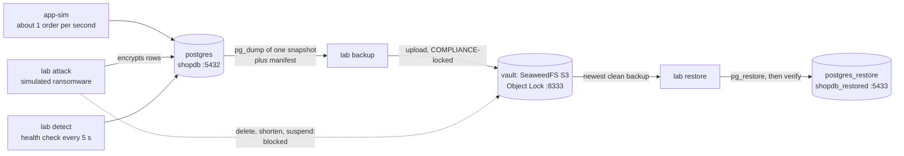
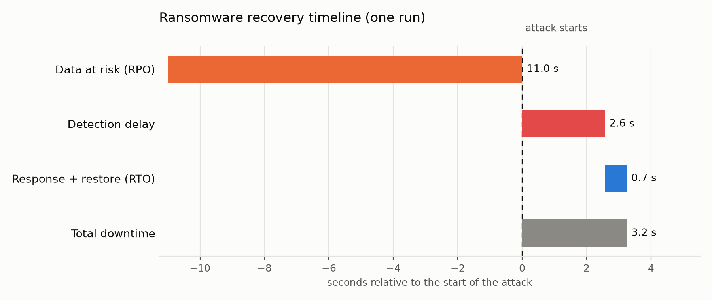

# ransomware-recovery-lab

A small, free, local lab that shows one idea end to end: **if ransomware hits your database and
the attacker has stolen admin credentials, immutable backups still let you recover, and you can
prove the recovered data is good.**

It runs on a laptop with Docker and Python, needs no accounts or paid services, and plays the
whole story with one command in roughly two minutes once the images are downloaded.

> **Simulation only.** The "ransomware" is a script that encrypts four columns in one local
> demo database, behind a safety guard (see [Safety](#safety)). It is not malware and it is not a
> test of any vendor's product.

## Overview

Ransomware operators routinely go after backups before they encrypt production data. This project
simulates that attack against a Postgres database and shows the recovery path end to end:

- Backups are written to an S3-compatible vault with **Object Lock in COMPLIANCE mode**, so even
  an attacker holding vault admin credentials cannot delete or shorten them.
- Each backup is a consistent snapshot with a manifest (SHA-256, row counts, per-table checksums,
  health verdict).
- The attack produces a **poisoned backup**: a valid backup of already-encrypted data. Restore
  detects and skips it.
- Recovery goes into an isolated clean-room database and is verified against the manifest.
- Every run produces a measured report: RPO, RTO, orders lost, detection delay and downtime.

## Features

- Consistent `pg_dump` snapshots taken while the application keeps writing
- Immutable, versioned, tagged backups with locked manifests
- Six simulated attacks on the vault, with the outcome of each recorded
- Continuous health-based detection with an incident timestamp
- Verified restore with automatic fallback to older backups
- Self-checking vault (`lab lockcheck`) that gates the demo
- Generated `RESULTS.md` and recovery timeline chart

## Getting started

**Prerequisites:** Docker (running) and Python 3.11 or newer.

```bash
git clone https://github.com/sanikaa29/Ransomware-recovery-lab.git
cd Ransomware-recovery-lab
make setup     # virtualenv, pinned dependencies, random local credentials in .env
make demo      # full scenario: backups, attack, detection, restore, report
```

The first run downloads the container images; the demo then takes roughly two minutes. Results are
written to `RESULTS.md` and `docs/img/timeline.png`. Other targets:

| Command | Purpose |
|---|---|
| `make test` | Unit tests |
| `make test-integration` | Integration test (needs `make up`) |
| `make lint` | Ruff |
| `make reset` | Remove all containers and data, including the vault |

Running individual steps is covered in [RUNBOOK.md](RUNBOOK.md).

## Architecture



Everything listens on `127.0.0.1` only.

## Components

| Piece | What it does |
|---|---|
| `postgres` / `postgres_restore` | Production database `shopdb`, and a separate clean-room server for restores. |
| `vault` | One SeaweedFS container exposing S3 with Object Lock. Bucket `lab-backups`, versioning on, Object Lock enabled at creation. |
| `lab lockcheck` | Gate: proves the vault really refuses to delete a locked version, shorten its retention or suspend versioning. The demo stops if it fails. |
| `lab backup [--loop]` | Consistent snapshot dump, SHA-256, row counts, per-table checksums, health verdict, manifest. Both objects are uploaded locked and tagged `health=clean` or `suspect`. |
| `lab attack` | The simulation, behind the guard. Encrypts `customers.email/phone/address` and `orders.notes` for every row in one transaction, then attacks the vault with the stolen admin identity. |
| `lab detect` | Checks database health every 5 seconds and prints a red INCIDENT line the first time it is suspect. |
| `lab restore` | Picks the newest trustworthy backup, verifies and restores it, falls back to an older one if verification fails. |
| `lab report` | Writes `RESULTS.md` and `docs/img/timeline.png` from the measured timeline. |
| `lab demo` | Runs all of the above as subprocesses with logs in `.lab/logs/`. |

Other commands: `up`, `down`, `seed`, `app-sim`, `health`, `backups`, `perms`.

## Results

From one real run of `make demo` on a MacBook Air, from a fresh checkout with `make setup && make demo` (12 Nov
2026, backups every 15 s, retention 10 minutes). Your numbers will differ; `RESULTS.md` is regenerated every run.

| Metric | This run | Meaning |
|---|---|---|
| RPO | 11.0 s | attack start minus the restored backup's snapshot time |
| Orders lost | 11 | orders that existed at attack start but not in the restored database |
| Detection delay | 2.6 s | attack start until the health check flagged it |
| Restore time | 0.5 s | restore start until verification passed |
| RTO | 0.7 s | detection until a verified restore |
| Total downtime | 3.2 s | attack start until a verified restore |

Vault results in the same run: 6 of 6 locked backup objects survived. Deleting locked
versions, shortening retention and suspending versioning were blocked. Deleting without a
version id only added a delete marker and overwriting only added a new version; both left the
locked original intact.



## Limitations

- **Tiny data.** About 205,000 rows and roughly 2 MB. Restore time says nothing about production
  databases.
- **RTO excludes people.** The demo starts the restore automatically. A real team adds
  reaction and approval time; `RESULTS.md` shows the response gap separately.
- **RPO is one sample** bounded by the backup interval (15 s in the demo, 60 s by default).
- **One machine.** The vault, the database and the credentials all live on your laptop. Anyone
  who controls the machine can delete the Docker volume, and no S3 lock stops that. A real
  deployment keeps the vault in a separate account or location. See
  [docs/THREAT_MODEL.md](docs/THREAT_MODEL.md).
- **Locks expire.** Retention is 10 minutes so the lab stays tidy; after that, deletion is
  allowed by design. Backups taken before the demo are not protected indefinitely.
- **The backup writer is a bucket admin** because SeaweedFS 4.53 would not accept locked uploads
  from a narrower identity. Reasoning and costs: [docs/DECISIONS.md](docs/DECISIONS.md).
- **Health rules are narrow.** They catch this lab's attack (invalid emails, a ransom table, a
  large row drop). Subtle corruption would pass them.
- **A simulated attacker** that only touches rows in one database. No spreading, persistence,
  file encryption or network activity.
- **Vendor behavior varies.** The Object Lock results hold for the SeaweedFS version tested
  (4.53). `lab lockcheck` exists so you can re-test any other S3 backend.

## Safety

`lab attack` refuses to run unless **all** of these are true: `LAB_MODE=true` in `.env`; the DB
host is `localhost` or `127.0.0.1`; the DB name is exactly `shopdb`; and you typed `ATTACK` (or
passed `--yes`). After connecting it also asks the server for its database name and aborts
unless it is `shopdb`. It only modifies rows in that one database, and unit tests prove it
refuses a wrong host and a wrong database name.

`.env` is generated locally with random credentials and is never committed. The attacker's
encryption key is written to `.lab/attacker.key` (also ignored by git).

## Documentation

| File | For |
|---|---|
| [RUNBOOK.md](RUNBOOK.md) | Running and fixing things |
| [docs/THREAT_MODEL.md](docs/THREAT_MODEL.md) | What is and is not protected |
| [docs/DECISIONS.md](docs/DECISIONS.md) | Design decisions backed by experiments |
