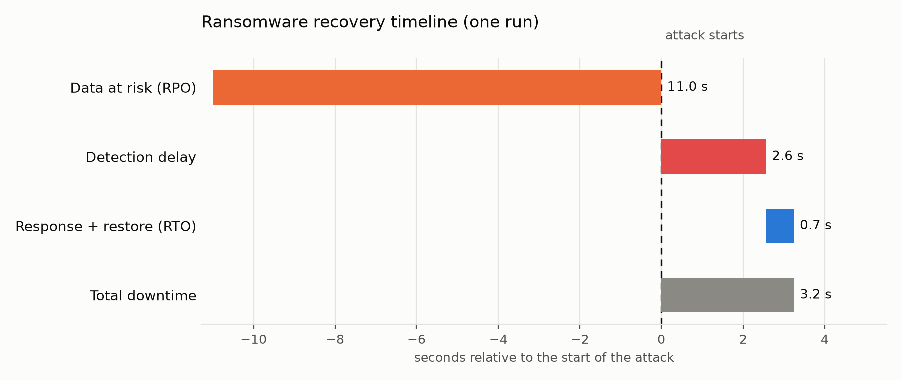

# Results of the last run

Generated by `lab report` at 2026-11-13 00:58:29Z from `.lab/timeline.json`. One run, one laptop: numbers change every run.

## Headline numbers

| Metric | This run | How it is measured |
|---|---|---|
| RPO (data at risk) | 11.0 s | attack start minus start of the restored backup's snapshot |
| Orders lost | 11 | newest order id at attack start minus newest id in the restored database |
| Detection delay | 2.6 s | health check flagged the damage after the attack began (polls every 5 s) |
| Response gap | 0.2 s | detection until the restore command started |
| Restore time | 0.5 s | restore start until verification passed |
| RTO | 0.7 s | detection until a verified restore (response gap + restore time) |
| Total downtime | 3.2 s | attack start until a verified restore |

## Timeline (UTC)

| Moment | Time |
|---|---|
| Restored backup's snapshot taken | 00:58:15.442388Z |
| Attack starts | 00:58:26.427170Z |
| Incident detected | 00:58:28.988725Z |
| Restore starts | 00:58:29.191517Z |
| Restore verified | 00:58:29.673740Z |

## What the attacker tried against the vault

| Attempted action | Result | Error code |
|---|---|---|
| Delete newest backup (no version id) | ALLOWED, DATA INTACT (delete marker only) | - |
| Delete locked backup versions | BLOCKED (6 versions) | AccessDenied |
| Overwrite newest backup with garbage | ALLOWED, DATA INTACT (new version added) | - |
| Shorten retention to 30 seconds | BLOCKED | AccessDenied |
| Suspend bucket versioning | BLOCKED | InvalidBucketState |
| Delete the bucket | BLOCKED (not the lock) | BucketNotEmpty |

A delete without a version id only adds a delete marker, and an overwrite only adds a new version: neither touches the locked original. Deleting the bucket failed because it was not empty, not because of the lock. 6 of 6 locked backup objects were still retrievable afterwards.

## Read this before quoting the numbers

- The simulated attack encrypted 55,042 rows in one transaction.
- The dataset is tiny (about 205,000 rows, roughly 2 MB), so restore time says nothing about production-sized databases.
- RTO here starts when detection fires. The demo triggers the restore automatically; a person would add their own reaction time (this run's response gap was 0.2 s).
- RPO is bounded by the backup interval (15 s in this run) and this is one sample: it can land anywhere from zero up to that interval.
- Detection delay is bounded by the 5 s polling interval.
- The attacker is a simulation on a local lab database; it is not a test of any vendor's product. Retention was 10 minutes so the lab stays tidy.
